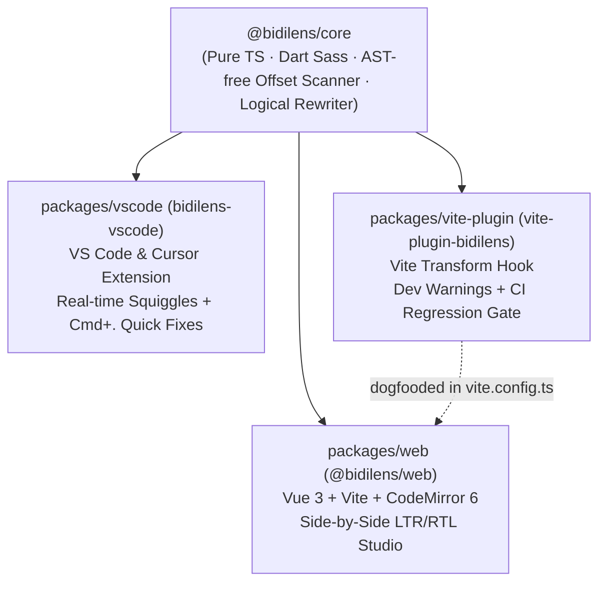

# BidiLens — Bidirectional CSS & Sass Logical Property Ecosystem

> **See and enforce your CSS in both directions.** A TypeScript monorepo decoupling a shared CSS/Sass logical property auditing & rewriting engine (`@bidilens/core`) across three developer tools: a **Vue 3 Live LTR/RTL Workbench**, a **VS Code / Cursor Extension**, and a **Vite Build Plugin**.

---

## Monorepo Architecture



```text
bidilens/
├── packages/
│   ├── core/          # @bidilens/core — Pure TS Sass compiler, scanner, logical fixer & Markdown reporter
│   ├── web/           # @bidilens/web — Vue 3 (<script setup>) + Vite live LTR/RTL workbench
│   ├── vscode/        # bidilens-vscode — VS Code / Cursor diagnostics + CodeAction Quick Fixes
│   └── vite-plugin/   # vite-plugin-bidilens — Dev-server warnings & CI build gate
├── .vscode/
│   ├── launch.json    # One-key F5 Extension Development Host launcher
│   └── tasks.json     # Pre-launch build task for @bidilens/core + bidilens-vscode
└── docs/adr/          # Architecture Decision Records (001, 002, 003)
```

---

## Supported Physical → Logical Mappings (`@bidilens/core`)

| Category | Physical CSS | Logical CSS Replacement |
| :--- | :--- | :--- |
| **Box Model** | `margin-left/right`, `padding-left/right`, `border-left/right` (+ `-width`/`-style`/`-color`) | `*-inline-start` / `*-inline-end` |
| **Positioning** | `left` / `right` | `inset-inline-start` / `inset-inline-end` |
| **Alignment & Float** | `text-align: left/right`, `float: left/right`, `clear: left/right` | `start/end`, `inline-start/inline-end` |
| **Corner Radii** | `border-top-left-radius`, `border-top-right-radius`, `border-bottom-left-radius`, `border-bottom-right-radius` | `border-start-start-radius`, `border-start-end-radius`, `border-end-start-radius`, `border-end-end-radius` |
| **Asymmetric Shorthands** | `margin` / `padding` / `inset` / `border-*` `T R B L` (when `R !== L`), asymmetric `border-radius` | `*-block: T B` + `*-inline: L R` / logical corner radii |

---

## Install & Use (Zero Clone Required)

Once published via the included release workflows (`.github/workflows/deploy-pages.yml` & `.github/workflows/release.yml`), developers can use BidiLens directly without cloning this repository:

- **Web Workbench:** Open the deployed URL on **GitHub Pages**, **Vercel** (`vercel.json`), or **Netlify** (`netlify.toml`) directly in any browser.
- **VS Code / Cursor Extension:** Search **"BidiLens"** in the VS Code Marketplace or Open VSX Registry (Cursor/Windsurf), or download `bidilens-vscode.vsix` from **GitHub Releases** and install via `code --install-extension bidilens-vscode.vsix`.
- **Vite Build Plugin:**
  ```bash
  npm install -D vite-plugin-bidilens
  ```
- **Programmatic Core Engine:**
  ```bash
  npm install @bidilens/core
  ```

### Publishing Your First Public Release
1. Push to GitHub `main` and enable **Settings → Pages → Source: GitHub Actions** to auto-deploy the Web Workbench (or import the repo in Vercel / Netlify).
2. Add optional repository secrets (`NPM_TOKEN`, `VSCE_PAT`, `OVSX_PAT`) in **GitHub Settings → Secrets → Actions**.
3. Push a version tag to publish to npm, VS Code Marketplace, Open VSX, and GitHub Releases automatically:
   ```bash
   git tag v1.0.0 && git push --tags
   ```

---

## Local Development Quick Start

### 1. Install & Build All Workspace Packages
```bash
npm install
npm run build
```

### 2. Run the Web Workbench (`packages/web`)
```bash
npm run dev
```
- **Features:** Split CodeMirror 6 HTML + `.scss`/`.sass` editors, 4 one-click **Sample Fixtures**, dual `<iframe sandbox="">` LTR/RTL live preview, viewport presets (`375px`, `768px`, `100%`), **Bounding Grid** overlay, **Original vs. Logical-Fixed** stream switch, `localStorage` persistence, and workbench **UI: LTR ⇄ RTL** toggle.
- **Shortcuts:** `Cmd/Ctrl + Enter` (Compile & Audit), `Cmd/Ctrl + Shift + F` (Auto-Fix All).

### 3. Debug the VS Code / Cursor Extension (`packages/vscode`)
1. Open this repository root in **VS Code** or **Cursor**.
2. Press **`F5`** (uses [.vscode/launch.json](./.vscode/launch.json) to compile `@bidilens/core` + `bidilens-vscode` and launch the **Extension Development Host**).
3. Open any `.css`, `.scss`, `.sass`, or `.vue` file containing physical properties (e.g., `margin-left: 16px;`) to inspect live warning squiggles and press **`Cmd+.` / `Ctrl+.`** for:
   - **"Convert to logical CSS property"** (single rule)
   - **"Fix all physical CSS in file"** (entire stylesheet or Vue `<style>` block)

### 4. Configure the Vite Build Plugin (`packages/vite-plugin`)
```ts
// vite.config.ts
import { defineConfig } from 'vite';
import vue from '@vitejs/plugin-vue';
import { bidilensPlugin } from 'vite-plugin-bidilens';

export default defineConfig({
  plugins: [
    bidilensPlugin({
      failOnError: process.env.CI === 'true',
      include: ['src/**/*.{css,scss,sass,vue}'],
      exclude: ['**/node_modules/**', '**/legacy/**'],
    }),
    vue(),
  ],
});
```

### 5. Run the Monorepo Test & Type-Check Suite
```bash
npm test          # Runs Vitest across core, web, vscode, and vite-plugin
npm run typecheck # Runs TypeScript project references (tsc -b)
```

---

## Architecture Decision Records
- [ADR 001: Shared-Core TypeScript Monorepo Architecture](./docs/adr/001-shared-core-monorepo-architecture.md)
- [ADR 002: Browser-Compatible Dart Sass Compilation & Offset-Preserving Logical Rewriter](./docs/adr/002-sass-compilation-and-logical-rewriter.md)
- [ADR 003: Sandboxed Dual-Iframe LTR/RTL Live Preview](./docs/adr/003-sandboxed-iframe-preview.md)
